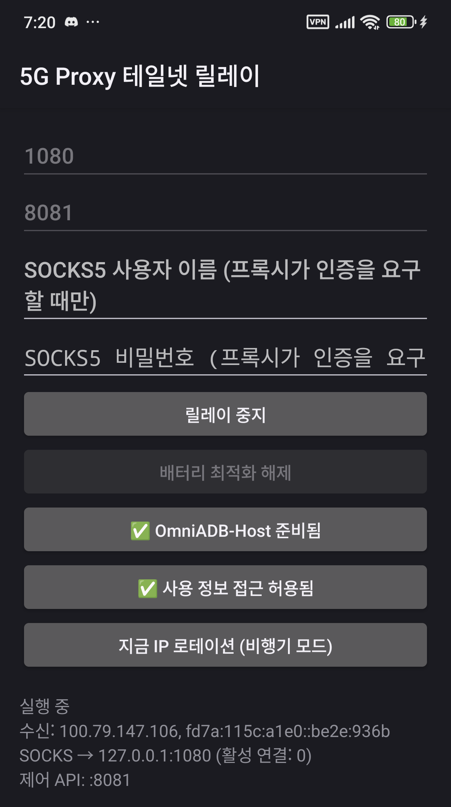

# 5G Proxy — Tailnet Relay

[English](README.md) · [繁體中文](README.zh-TW.md) · **한국어**

<p align="center">
  
</p>

Tailnet(Tailscale 또는 호환 클라이언트)에 연결된 어떤 기기에서든, 안드로이드 폰에서
실행 중인 SOCKS5 프록시에 접속할 수 있게 해 주는 작은 컴패니언 앱입니다. 트래픽은
집의 인터넷 회선이 아니라 폰의 **셀룰러** 회선으로 나갑니다.

[5G Proxy Pro](https://github.com/tokyoxpa3/5G-Proxy-Pro)와 함께 쓰도록 만들어졌지만,
업스트림은 폰에서 실행되는 **어떤** SOCKS5 프록시든 됩니다.

## 왜 필요한가

안드로이드의 per-app VPN은 UID 단위로 동작합니다. 폰에서 Tailscale 같은 클라이언트가
돌고 있으면, 프록시 앱은 VPN에서 *제외*되어야 셀룰러 인터페이스로 나갈 수 있습니다.
하지만 제외되는 순간 클라이언트의 `tun0`으로 들어오는 연결을 받을 수 없게 됩니다.

Tailnet Relay가 그 빈자리를 채웁니다.

```
노트북 ──tailnet──▶ Relay (VPN 내부) ──127.0.0.1:1080──▶ 프록시 ──▶ 셀룰러
```

릴레이는 VPN 안에 남아 테일넷 주소에서 TCP를 받고, 프록시의 루프백 리스너로
전달합니다. 두 앱은 각자의 UID를 유지하므로 프록시는 계속 셀룰러로 나가고, 트래픽은
테더링 인터페이스를 거치지 않습니다.

## 권장: OmniADB-Host와 함께 사용

IP 로테이션을 쓰려면 [OmniADB-Host](https://github.com/tokyoxpa3/OmniADB-Host)를
함께 설치하세요.

없을 때 `/rotate`에는 두 가지 방법밖에 없습니다. 기본 디지털 어시스턴트를 넘겨주거나,
`WRITE_SECURE_SETTINGS`에 의존하는 것인데 후자는 Android 15 이상에서 라디오를 끄지
못합니다. OmniADB-Host가 있으면 릴레이는 고정된 네 가지 동작만 노출하는 좁은
프로바이더(`airplane_on`, `airplane_off`, `grant_secure`, `ping`)를 호출합니다.
덕분에 루트 없이, 어시스턴트를 빼앗지 않고, Wi-Fi도 끊지 않고 로테이션이 됩니다.

OmniADB-Host는 범용 adb 셸이 아닙니다. 이 네 가지 메서드만 존재하고, 호출자 UID가
이 앱의 패키지명과 일치해야 합니다. 설치되어 있지 않으면 릴레이는 조용히 나머지 두
백엔드로 넘어갑니다.

## 요구 사항

- Android 8.0(API 26) 이상
- 폰에 테일넷 클라이언트 (Tailscale, 또는 `100.64.0.0/10` /
  `fd7a:115c:a1e0::/48`을 쓰는 호환 클라이언트)
- 폰에서 SOCKS5 프록시가 수신 대기 중 (5G Proxy Pro는 기본값 `127.0.0.1:1080`)
- UI는 영어, 중국어 간체, 중국어 번체, 한국어를 지원합니다 (시스템 언어를 따르며,
  Android 13 이상에서는 앱별로 지정할 수 있습니다)

## 동작

- 테일넷 주소에만 바인딩합니다(`tun*` + CGNAT 대역). 셀룰러나 LAN 인터페이스에는
  절대 바인딩하지 않습니다.
- TCP를 설정 가능한 로컬 SOCKS5 업스트림(기본 `127.0.0.1:1080`)으로 전달합니다.
- 선택 사항인 HTTP 제어 API(`/status`, `/rotate`)를 제공하며, 베어러 토큰으로
  보호합니다.
- 선택 사항인 IP 로테이션: 비행기 모드를 전환해 모뎀이 다시 attach하도록 강제합니다.
- 재부팅 후 스스로 복구되지만, **"재부팅 후 릴레이 자동 시작"이 체크되어 있고**
  **종료 전에 릴레이가 실행 중이었을 때**만 그렇습니다. 중지 버튼을 누르면 다시 올라오지
  않습니다. 이 옵션이 생기기 전에도 동작이 같았으므로 체크박스는 기본으로 켜져 있습니다.

## 제한 사항

- **TCP만 지원합니다.** 표준 UDP ASSOCIATE는 구현되어 있지 않아 QUIC, 일부 게임,
  VoIP는 릴레이를 통과하지 못합니다. 유일한 UDP 경로는
  [5G Proxy Client](https://github.com/tokyoxpa3/5G-Proxy-Client)가 쓰는 `0x04`
  UDP-in-TCP 확장입니다.
- 테일넷이 연결되어 있어야 하며, 폰은 항상 켜져 있고 신호가 있어야 합니다.
- 모든 클라이언트가 폰의 셀룰러 IP 하나를 공유합니다.

## IP 로테이션 백엔드

`/rotate`는 다음 순서로 시도합니다.

1. **OmniADB-Host** — 위에서 설명한 좁은 프로바이더. 우선 사용: 루트 불필요,
   어시스턴트를 빼앗지 않음, Wi-Fi 유지.
2. **`WRITE_SECURE_SETTINGS`** — 전환 중 Wi-Fi만 유지합니다. Android 15 이상에서는
   라디오를 **전환하지 못합니다**.
3. **기본 디지털 어시스턴트** — `ACTION_VOICE_CONTROL_AIRPLANE_MODE`. adb 없이
   실제로 라디오를 전환할 수 있는 유일한 경로입니다.

모든 시도는 기록된 설정값이 아니라 라디오 상태(`awaitRadio()`)로 검증합니다.

## 프록시 또는 로테이션 백엔드 전환

**다른 SOCKS5 프록시로 바꾸기.** 포트를 바꾸고, 프록시가 인증을 요구하면 사용자
이름과 비밀번호도 바꾼 뒤 *릴레이 중지* → *릴레이 시작*을 누르세요. `127.0.0.1`에
바인딩된 어떤 프록시든 됩니다. 릴레이는 다른 기기에 있는 프록시로 전달하지
않습니다.

**다른 로테이션 백엔드로 바꾸기.** 로테이션 버튼은 항상 현재 감지된 백엔드를
보여 주고, 탭하면 선택 창이 열립니다.

| 버튼 상태 | 탭했을 때 |
|---|---|
| IP 로테이션 설정 (탭하여 선택) | 선택 창 열림 — 아직 설정되지 않음 |
| 시스템 설정으로 비행기 모드 전환 가능 (탭하여 보기) | 선택 창 열림 — 변경 가능 |
| 디지털 어시스턴트로 대체 (탭하여 변경) | 선택 창 열림 — 변경 가능 |
| OmniADB-Host 준비됨 | 아무 동작도 하지 않음 (의도된 설계) |

마지막 줄은 의도된 것입니다. OmniADB-Host가 이미 가장 좋은 백엔드이므로(루트 불필요,
어시스턴트를 빼앗지 않음, Wi-Fi 유지) 더 나은 것으로 바꿀 대상이 없습니다. 다른
백엔드를 강제로 쓰려면 OmniADB-Host를 삭제하거나 비활성화하거나, 앱 데이터를
지우세요.

백엔드는 계속 다시 감지되므로, OmniADB-Host를 설치하면 앱을 재시작하지 않아도
인식됩니다.

## 제어 API

```bash
curl -H "Authorization: Bearer <token>" http://<tailnet-ip>:8081/status
curl -H "Authorization: Bearer <token>" http://<tailnet-ip>:8081/rotate
```

토큰은 `?token=`으로도 전달할 수 있습니다. **토큰을 가진 사람은 폰을 네트워크에서
끊을 수 있습니다.** 비밀로 취급하세요.

## 빌드

```bash
./gradlew :app:assembleDebug
```

저장소 루트에 `keystore.properties`가 있을 때만 release 빌드에 서명합니다. 없으면
서명되지 않은 APK가 출력됩니다.

## 라이선스

MIT — [LICENSE](LICENSE) 참고.

## 크레딧

릴레이는 원래 [@bokukpark](https://github.com/bokukpark) 님이
[5G-Proxy-Pro#6](https://github.com/tokyoxpa3/5G-Proxy-Pro/pull/6)에서 기여했습니다.
이 저장소는 그 히스토리와 저자 정보를 그대로 보존합니다.
