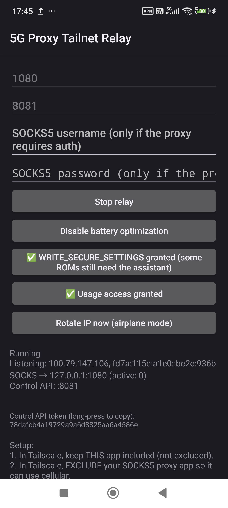

# 5G Proxy — Tailnet Relay

**English** · [繁體中文](README.zh-TW.md) · [한국어](README.ko.md)

<p align="center">
  
</p>

A small companion app that lets any device on your [Tailscale](https://tailscale.com)
(or compatible) tailnet reach a SOCKS5 proxy running on an Android phone, so the
traffic leaves through the phone's **cellular** connection instead of your home
broadband.

It ships alongside [5G Proxy Pro](https://github.com/tokyoxpa3/5G-Proxy-Pro) but
works with **any** SOCKS5 proxy on the phone.

## Why this exists

Android applies per-app VPN by UID. When a tailnet client such as Tailscale runs
on the phone, the proxy app must be *excluded* from the VPN so that its outbound
traffic uses the cellular interface — but once excluded, it can no longer receive
connections arriving on the client's `tun0` interface.

Tailnet Relay is the missing piece:

```
laptop ──tailnet──▶ Relay (inside the VPN) ──127.0.0.1:1080──▶ Proxy ──▶ cellular
```

The relay stays inside the VPN, accepts TCP on the tailnet address and forwards
it to the proxy's loopback listener. The two apps keep separate UIDs, so the
proxy keeps using the cellular exit and the traffic never touches the tethering
interface.

## Recommended: pair it with OmniADB-Host

If you want IP rotation, install [OmniADB-Host](https://github.com/tokyoxpa3/OmniADB-Host)
next to this app.

Without it, `/rotate` has only two options: hand over your default digital
assistant, or rely on `WRITE_SECURE_SETTINGS`, which cannot toggle the radio on
Android 15 and newer. With OmniADB-Host installed, the relay calls a narrow
provider that exposes four fixed actions — `airplane_on`, `airplane_off`,
`grant_secure`, `ping` — so rotation works without root, without taking over the
assistant, and without dropping Wi-Fi.

OmniADB-Host is not a general adb shell: only those four methods exist, and the
caller UID must match this app's package name. If the host is not installed, the
relay silently falls back to the other two backends.

## Requirements

- Android 8.0 (API 26) or newer
- A tailnet client on the phone (Tailscale, or a compatible client that uses
  `100.64.0.0/10` / `fd7a:115c:a1e0::/48`)
- A SOCKS5 proxy listening on the phone (5G Proxy Pro listens on
  `127.0.0.1:1080` by default)
- UI in English, Simplified Chinese, Traditional Chinese or Korean (follows the
  system language; Android 13+ can override it per app)

## What it does

- Listens on the tailnet address only (`tun*` + the CGNAT range). It never binds
  to the cellular or LAN interfaces.
- Forwards TCP to a configurable local SOCKS5 upstream (default
  `127.0.0.1:1080`).
- Exposes an optional HTTP control API (`/status`, `/rotate`) protected by a
  bearer token.
- Optionally rotates the cellular IP by toggling airplane mode, forcing the
  modem to re-attach.

## Limitations

- **TCP only.** Plain UDP ASSOCIATE is not implemented, so QUIC, some games and
  VoIP will not work through the relay. The `0x04` UDP-in-TCP extension used by
  [5G Proxy Client](https://github.com/tokyoxpa3/5G-Proxy-Client) is the only UDP
  path.
- Requires an active tailnet; the phone must stay awake and online.
- All clients share the phone's single cellular IP.

## IP rotation backends

`/rotate` tries the following, in order:

1. **OmniADB-Host** — the narrow provider described above. Preferred: no root, no
   assistant takeover, Wi-Fi stays up.
2. **`WRITE_SECURE_SETTINGS`** — only keeps Wi-Fi alive during the toggle. On
   Android 15+ it does **not** switch the radio.
3. **Default digital assistant** — `ACTION_VOICE_CONTROL_AIRPLANE_MODE`, the only
   path without adb that actually toggles the radio.

Every attempt is verified against the radio state (`awaitRadio()`), not against
the value that was written.

## Switching the proxy or the rotation backend

**A different SOCKS5 proxy.** Edit the port, and the username/password if the
proxy requires authentication, then tap *Stop relay* and *Start relay*. Any
proxy bound to `127.0.0.1` works — the relay never forwards to a proxy on
another device.

**A different rotation backend.** The rotation button always shows the backend
that is currently detected, and tapping it opens the picker:

| Button state | What tapping does |
|---|---|
| Set up IP rotation (tap to choose) | Opens the picker — nothing is configured yet |
| Airplane via system setting (tap for details) | Opens the picker — you can change it |
| Digital assistant fallback (tap to change) | Opens the picker — you can change it |
| OmniADB-Host ready | Nothing, by design |

The last row is deliberate. OmniADB-Host is already the preferred backend (no
root, no assistant takeover, Wi-Fi stays up), so there is nothing better to
switch to. To force another backend, uninstall or disable OmniADB-Host, or clear
the app's data.

The backend is re-detected continuously, so installing OmniADB-Host is picked up
without restarting the app.

## Control API

```bash
curl -H "Authorization: Bearer <token>" http://<tailnet-ip>:8081/status
curl -H "Authorization: Bearer <token>" http://<tailnet-ip>:8081/rotate
```

The token may also be passed as `?token=`. **Anyone holding the token can cut the
phone off the network** — treat it as a secret.

## Build

```bash
./gradlew :app:assembleDebug
```

Release builds are signed only when `keystore.properties` exists in the
repository root; otherwise the output APK is unsigned.

## License

MIT — see [LICENSE](LICENSE).

## Credits

The relay was originally contributed by
[@bokukpark](https://github.com/bokukpark) in
[5G-Proxy-Pro#6](https://github.com/tokyoxpa3/5G-Proxy-Pro/pull/6). This
repository preserves that history and authorship.
